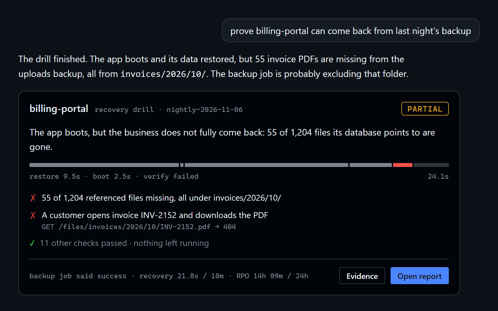
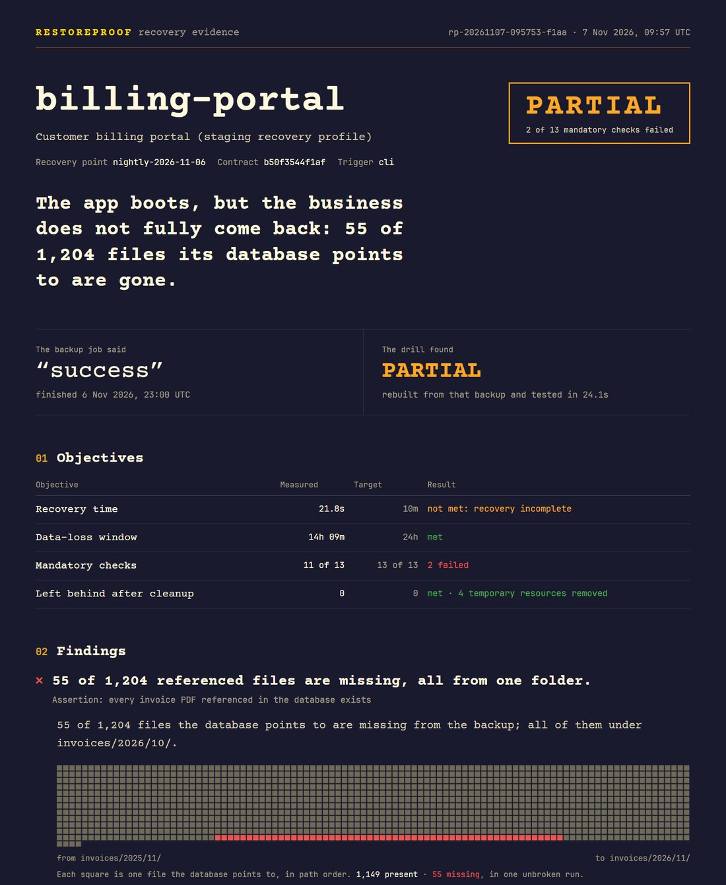

<p align="center">
  
</p>

<p align="center">
  <a href="#install">Install</a> ·
  <a href="#what-a-drill-proves">What a drill proves</a> ·
  <a href="#the-recovery-contract">Recovery Contract</a> ·
  <a href="#inside-hermes">Inside Hermes</a> ·
  <a href="#safety">Safety</a> ·
  <a href="#the-name">The name</a>
</p>

---

Every night the backup job says **success**. That proves a file was written. It does not prove the
business can come back.

RestoreProof is a Hermes Agent plugin that rebuilds your app from its backups in an isolated Docker
network, then checks what your customers would actually get: every database row that points at a file,
a real user journey, recovery time and data-loss window. It cleans up after itself and hands you evidence
nobody has to take on faith. No language model decides a verdict.

<p align="center">
  
</p>

The run above is real. The backup job reported success. The database restored, the service booted and
`/health` answered 200. And 55 customers still could not open their invoices, because one month of PDFs
never made it into the uploads archive. A green health check would have hidden that until the day you
needed the backup.

## Install

```bash
hermes plugins install Surajkumar5050/restoreproof --enable
```

Once it is listed in the Hermes catalog, `hermes plugins install restoreproof --enable` does the same.
In Hermes Desktop, turn on the plugin's Desktop part in **Capabilities → Plugins** for the pane and the
inline evidence card.

You need Docker. Then try the bundled demo, a billing portal whose "successful" backup is quietly broken:

```bash
python examples/billing-portal/setup_demo.py
```

```bash
hermes restoreproof run examples/billing-portal/restoreproof.yaml
```

Or just ask Hermes: *"prove billing-portal can come back from last night's backup."*

## What a drill proves

A drill is a fixed sequence of deterministic stages. Each one either produces evidence or stops the claim.

| Stage | What it checks | Why a backup status can't |
|---|---|---|
| **Preflight** | Every artifact exists, matches the digest the backup job recorded, and is safe to unpack. Archives are inspected member by member for path traversal, links, device files and bombs before a byte is written. | A file can exist and still be truncated, tampered with or hostile. |
| **Isolate** | A fresh Docker network with `--internal`: no route to the internet or to production. | A restore that can reach real services is not a test. |
| **Restore** | The database dump into a throwaway PostgreSQL; file archives into scratch storage. | "The dump is there" is not "the dump loads". |
| **Boot** | Your app image starts from the restored data and its health endpoint answers. | Most backup tools stop before this. |
| **Verify** | Your declared checks: SQL invariants, **every** database reference to a file (not a sample), and real customer journeys run from inside the network. | The health check passed. The customers still got a 404. |
| **Clean up** | Every container, network and volume it created is removed, then looked for again to prove it. Restored data is deleted. | A drill that leaves debris is a drill nobody runs twice. |

Then it measures **recovery time** (start to the last mandatory check) and **RPO** (your declared incident
time minus the newest data that came back), and writes a report with a sha256 you can verify.

### Verdicts

| Verdict | Meaning |
|---|---|
| `PASS` | Every mandatory check in the contract passed. |
| `PARTIAL` | The app boots, but a declared customer workflow does not come back. |
| `FAIL` | An artifact, the restore, or the boot failed. |
| `BLOCKED` | The drill could not run safely: a missing secret, image or Docker. Nothing was started. |
| `INCONCLUSIVE` | Not enough evidence for a verdict: a timeout or an infrastructure fault. |

A skipped check never counts as passed, and `BLOCKED` or `INCONCLUSIVE` is never shown as `PASS`.

## The Recovery Contract

Recovery as an executable agreement: what "recovered" means for one app, in a file that lives next to
your `docker-compose.yml`. Every field maps to a fixed, validated operation. Nothing in it runs as a shell
command, and SQL checks must be single read-only `SELECT` statements.

```yaml
restoreproof: 1
app: { name: billing-portal }
recovery_point: { dir: backups/nightly-2026-11-06, status_file: backup-status.json }
database: { engine: postgres, artifact: db.sql.gz, name: billing, user: billing }
files:
  - { name: uploads, artifact: uploads.tar.gz, mount: /data/uploads }
service:
  image: restoreproof-demo/billing-portal:1.0
  env: { DATABASE_URL: "postgresql://{db.user}:{db.password}@{db.host}:{db.port}/{db.name}" }
checks:
  references:
    - name: every invoice PDF referenced in the database exists
      sql: select number, pdf_path from invoices where pdf_path is not null
      files: uploads
  journeys:
    - name: a customer opens invoice INV-2152 and downloads the PDF
      steps:
        - { get: /api/invoices/INV-2152, expect_status: 200, capture: { pdf_url: $.pdf_url } }
        - { get: "{pdf_url}", expect_status: 200, expect_header: { content-type: application/pdf } }
objectives: { rto: 10m, rpo: 24h, rpo_watermark_sql: select max(created_at) from invoices }
```

You rarely write one from scratch. `restoreproof_discover` reads your compose file and backups and drafts
it, including a **backup coverage map**: in the demo it finds by itself that the `exports` volume is not in
any backup. Hermes then asks you one question, which customer action proves the app works, and turns the
answer into a journey.

## Inside Hermes

RestoreProof is built into every Hermes surface. A skill could not restore a database; this does.

<p align="center">
  
</p>

- **Seven tools** the agent drives: `discover`, `plan`, `run_drill`, `report`, `compare`, `history`, `cleanup`.
- **An approval gate bound to the contract's sha256.** Answer "always" once and that exact contract can run
  unattended, even under Hermes's default `cron_mode: deny`. Edit the contract and its hash changes, so the
  next unattended run is refused until you approve again.
- **`/drill`** in any session or chat app, and **`hermes restoreproof`** for CI and cron
  (exit `0` PASS, `1` PARTIAL or FAIL, `2` BLOCKED or INCONCLUSIVE).
- **A live status message** that edits itself in place while the drill runs.
- **Hermes Desktop:** a pane that follows the drill stage by stage, a status bar chip, the evidence card
  above inline in chat, and the full report in a sandboxed tab. Every color comes from your active theme.
- **A "Nightly recovery drill" automation blueprint.** At 03:30 your phone gets the verdict, not a
  guess:

```text
Nightly drill · billing-portal · PARTIAL
✗ 55 of 1,204 referenced files missing (invoices/2026/10/)
✗ GET /files/invoices/2026/10/INV-2152.pdf returns 404
Recovery time 14.3s (target 10m, not met: recovery incomplete)
Data-loss window (RPO) 14h 09m (target 24h, met)
11 of 13 checks passed. Nothing left running.
Report rp-20261107-094452-af01
```

### The evidence report

A case file you can forward to whoever asks "are we covered?". Fonts are embedded, so it reads the same
offline and in print.

<p align="center">
  
</p>

## Safety

A tool that restores data and starts applications handles sensitive and possibly hostile material.
Safety is the design, not a disclaimer.

- **The model never decides.** It can draft a contract and explain evidence. Restore operations,
  assertions and verdicts are deterministic code.
- **Fails closed.** Missing secrets, images or Docker give `BLOCKED` before anything starts. An engine
  fault is `INCONCLUSIVE`, never a result.
- **No network surprises.** Drills never pull images; the restored app runs on an internal network with
  no egress, and journeys run from a probe container inside it. The app is never published to your host.
- **Least privilege.** The app runs with `--cap-drop ALL`, `no-new-privileges`, memory and pid limits,
  and no host mounts.
- **Secrets stay secret.** Resolved only through Hermes's secret store, passed to containers through a
  private env file that is deleted with the run, and redacted from every log and report. A test checks
  that a planted secret appears in no evidence file.
- **Honest isolation.** This is container isolation for your own trusted backups and images, not a VM
  boundary for hostile ones, and the report says so.

## Tested

Unit tests for contract validation, archive attacks and verdict logic, plus eight end-to-end scenarios
that run **real drills** against Docker and assert the verdict and that nothing is left behind:

broken backup → `PARTIAL` with exactly 55 missing files · fixed backup → `PASS` with the same contract ·
missing dump → `FAIL` · tampered archive → `FAIL` on its digest · path-traversal archive rejected before
extraction · app that cannot reach its database → `FAIL` at boot · missing secret → `BLOCKED` with nothing
started · secret value never present in any evidence file.

```bash
python -m unittest discover -s tests -p "test_*.py"
```

## What it touches

For the catalog's disclosure rules, in one place:

- **Runs** the `docker` CLI (argument lists, never a shell) to create, inspect and remove containers,
  networks and volumes labelled `restoreproof.run`.
- **Reads** only the backup folder and contract you point it at.
- **Writes** run evidence under Hermes's plugin data directory, and `restoreproof.draft.yaml` only when you
  ask discovery to.
- **Network:** none of its own. No telemetry. Docker images must already be present locally.

## Limits

PostgreSQL dumps (`.sql`, `.sql.gz`, pg_dump custom format), tar archives and one application image per
contract today. MySQL, S3-compatible object storage and multi-service graphs are next. It complements your
backup tool; it does not take backups.

## The name

<p align="center">
  
</p>

Hermes is the god who walks between worlds. On this bowl, painted in Athens around 440 BCE, he stands
beside Persephone as she rises out of the underworld, while Hekate lights the way and Demeter waits.
Everyone in the scene knows the return is the hard part.

RestoreProof checks whether your app can make the same trip, before the day it has to.

---

<sub>
Art: <a href="https://www.metmuseum.org/art/collection/search/252973">Terracotta bell-krater, the Return of Persephone</a>,
Persephone Painter, ca. 440 BCE, and <a href="https://www.metmuseum.org/art/collection/search/254925">Marble statue of Hermes</a>,
1st–2nd century CE. The Metropolitan Museum of Art, Open Access (CC0). Treatments by <code>scripts/build_readme_art.py</code>.
Fonts: Courier Prime and JetBrains Mono, SIL Open Font License 1.1 (<code>licenses/</code>).
RestoreProof is MIT licensed. It is an independent community plugin, not affiliated with Nous Research.
</sub>
